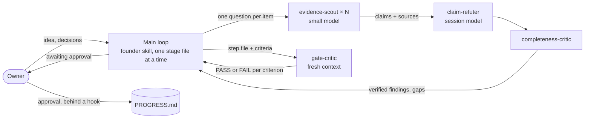

# How Founder Pipeline is built

Built and maintained by Marian Kamenistak. The reasoning behind the pipeline, and a full run on a real idea, are in [How to Use Claude Code to Kill or Launch a Business Idea](https://www.marian.coach/blog/how-to-validate-a-business-idea-before-building/).

This page is for someone who wants to know how the plugin is put together, what it costs in context, and how a change to it is checked. Every number below comes from a command in this repo, and the command is named next to it.

## What ships

| Component | Count | Where | Job |
|---|---:|---|---|
| Skills | 23 | `plugins/founder-pipeline/skills/` | `founder` runs the pipeline; 22 specialists do one job each (critic, pricing, prediction, voice, SEO, launch) |
| Subagents | 4 | `agents/` | The roles the pipeline delegates to, with model tier and tools fixed in the file |
| Workflows | 2 | `workflows/` | Deterministic fan-out for research sweeps and gate panels |
| Hook | 1 | `hooks/` | Asks the owner before a step is marked `approved` |
| Evals | 7 cases | `evals/` | Behaviour tests for `claude plugin eval` |
| Unit tests | 50 | `tests/` | The linter (24), the hook (11), the workflow logic (9), the listings filter (6) |

## The shape



Judgment is serial and belongs to a person. Research is parallel and cheap. Those two sentences explain most of the design.

## Design decisions

### 1. The step sequence is serial and human-gated

The 25 steps run one at a time and each waits for the owner's sign-off. A workflow engine does not drive the sequence, because a parallel run across steps either skips a gate or builds on a guess nobody approved. Parallelism is allowed inside a step, and for six named pairs of steps that were checked for dependencies (`skills/founder/references/pipeline-contract.md`).

### 2. One stage file at a time

`founder/SKILL.md` is the orchestrator: the run loop, the hard rules and a table of when to read each reference. Each step's instructions live in their own file under `stages/`, and the skill reads one per step. The main conversation holds that file, `brief.md` and at most one earlier artifact. Anything heavier goes to a subagent that returns its conclusion.

Each stage file opens with a `Routing:` line, for example:

```
**Routing:** fan-out (one agent per competitor, then adversarial verification of each weakness) · scouts CHEAP, verify PEAK · gate critic at the step tier
```

In 0.2.0 that information sat only in a 27 KB routing map that no stage file pointed to. The line puts it where the step is read.

### 3. Roles are components, with the tier in the file

| Agent | Model | Effort | Tools | Contract |
|---|---|---|---|---|
| `evidence-scout` | `haiku` | low | read and web, no write | One item, one question, fixed fields. A source and a date per field. `NOT_FOUND` is a valid answer |
| `claim-refuter` | `inherit` | high | read and web, no write | One claim. Answers `REFUTED` when it can neither verify nor break it |
| `completeness-critic` | `inherit` | high | read only | Asks only "what is missing". Each gap becomes the next action |
| `gate-critic` | `inherit` | high | read and web, no write | PASS or FAIL per criterion with evidence, a `GATE` line and a score. Has not seen the drafting conversation |

`inherit` means the critics run on the model the session runs on, so a critic is as strong as the main loop that wrote the draft. The scout is pinned to the small model because its work is structured and checkable. Agent files use aliases, and skill text names tiers (PEAK, HIGH, MID, CHEAP). The one dated mapping to model names is a table in `skills/founder/INSTALL.md`, so a model release edits one table.

The linter rejects an agent that asks for `Write`, `Edit` or `Bash`, and one that names a dated model ID.

### 4. Two workflows, both opt-in

`gather-verify` runs a scout per item, sends each load-bearing claim to a refuter as soon as its scout returns, and ends with the completeness critic. `judge-panel` runs one gate critic per framing, blind to the others, for the two kill gates.

Three rules are written into the scripts and tested:

- **The gate is computed, not reported.** `judge-panel` ignores the critic's own summary line. It passes only when every criterion was judged, every one passed and nothing is blocking.
- **A dead agent counts against the claim.** A refuter that returns nothing means "refuted". A critic that returns nothing means "not complete".
- **Nothing is dropped silently.** Items with no result and claims beyond the per-item cap are logged and returned, and they stop the sweep from being called complete.

The scripts set no model. The agent definitions own that. A workflow starts many agents at once, so the skill offers it and waits for a yes.

### 5. One rule is enforced in code

The pipeline's central promise is that a step is `approved` only when the owner says so. Prose cannot guarantee that, so a `PreToolUse` hook checks it: an edit that adds an `approved` row to a pipeline `PROGRESS.md` becomes a permission prompt. So does a shell command that writes to a `PROGRESS.md` and mentions `approved` (`sed -i`, a redirect, `tee`, a script). The shell check reads the command text, so it is best effort: it cannot see what a script file does.

What the hook does and does not do, as tested on Claude Code 2.1.322:

- Default permission mode, interactive: the owner gets a prompt and clicks.
- Default permission mode, headless: nobody can click, the edit is refused, and the row stays `awaiting approval`. That is the intended result for an unattended run.
- `acceptEdits` and `bypassPermissions`: Claude Code accepts the prompt automatically, so the hook adds nothing. The unattended-mode guide tells you to launch in the default mode with an allowlist for this reason.

It only asks. It does not deny on its own, it ignores a `PROGRESS.md` that lacks the pipeline's column header, and on any error it lets the edit through, because a guard that crashes must not block unrelated work in a user's session. That is a deliberate trade: the hook raises the cost of skipping the sign-off, and the rule in the skill still carries the rest. There is one hook because a hook runs on every matching tool call in every session of every user; the shell matcher is narrowed with an `if` filter so it only runs for commands that name `PROGRESS.md`.

### 6. It works with nothing else installed

Every skill and tool the pipeline mentions resolves in three steps: the bundled one, then the user's own, then an inline fallback card in `skills/founder/references/capabilities.md`. The first step writes what it found to `CAPABILITIES.md`. A missing capability changes how a step works and does not remove its gate. A missing data source marks the check `BLOCKED`; the pipeline does not fill it with an estimate.

The founder skill is also documented as installable by copying its folder alone. The linter fails if any file in that folder uses `${CLAUDE_PLUGIN_ROOT}`, which is empty outside a plugin install. 0.2.0 had seven such files.

No MCP server is bundled. A bundled server would start for every user, including those with no account for it. `examples/mcp.json` has the five servers the pipeline can use, to copy into a project.

### 7. Unattended mode has hard limits

`overnight` swaps the owner's sign-off for a fresh-context critic and leaves every step at `awaiting approval`. It may not invent evidence, send a message to a person, or run without a profit bar. Since 0.3.0 it deploys to a preview URL unless the kickoff says `deploy: production`, stops at a time limit, and stops when a `STOP` file appears in the stream folder.

## Context cost

Run `python3 scripts/check_skills.py --report` for the full table. Tokens are an estimate at 4 characters per token.

| What | 0.2.0 | 0.3.0 | Limit enforced by the linter |
|---|---:|---:|---:|
| Always loaded: 23 skill descriptions | 15,647 chars | 9,824 chars | |
| Always loaded: 4 agent descriptions | none | 1,257 chars | |
| Always loaded, total | 15,647 chars | 11,081 chars, about 2,770 tokens | 11,500 chars |
| Descriptions over the 1,024-char spec limit | 3 | 0 | 0 |
| `founder/SKILL.md` body, loaded when the pipeline starts | 32,803 chars | 17,025 chars, about 4,256 tokens | 20,000 chars |
| `SKILL.md` bodies over 20,000 chars | 5 | 0 | 0 |
| Stage file, loaded per step | 3,300 to 18,491 chars | 3,744 to 18,675 chars | none |

The 0.2.0 figures come from the same script run on commit `3ebc69f`. The stage `Routing:` lines name a tier per role; the shipped `gate-critic` inherits the session model at every step, so it runs at or above the tier a step asks for. The main loop's tier is the one tier nothing enforces: it is whatever model the owner starts the session on. Descriptions got shorter by saying when to use the skill and dropping the summary of what it does. Bodies got shorter by moving whole sections, word for word, into `references/` behind a pointer that says when to read them.

## How a change is checked

| Layer | Catches | Runs |
|---|---|---|
| `scripts/check_skills.py` | Invalid YAML, unknown frontmatter keys, spec limits, budgets, dangling file and skill references, a referenced file that exists locally but is gitignored, a broken standalone install, agents with write tools or dated model IDs, workflows that pin a model or read the clock, a version with no changelog entry | CI, every push |
| `tests/test_check_skills.py` | A linter that stops catching one of those. Each of the 24 tests builds a broken plugin and asserts the exact error | CI |
| `tests/approval-guard.test.mjs` | The hook asking when it should not, staying silent when it should ask, or blocking on bad input | CI |
| `tests/workflows.test.mjs` | Orchestration logic, run against a mocked runner with no model calls | CI |
| `scripts/verify-release.sh` | Personal data, credential-shaped strings, machine paths, private names | CI and before each push |
| `claude plugin validate --strict` | Manifest and schema errors | CI |
| `claude plugin eval` | Behaviour: does the plugin still refuse what it should refuse | Before each release, on the maintainer's machine, because it calls a model |

### Behaviour evals

Seven cases, three runs each, scored 0 to 1. A case passes only at 1.00. "No plugin" is the same prompt with nothing installed. Run on 2026-11-13 with Claude Code 2.1.323 and its default model. The summary is `docs/eval-results/v0.3.0.json`, and the raw output, with every grader verdict for every run, is in `docs/eval-results/raw/`.

| Case | What it checks | No plugin | 0.2.0 | 0.3.0 |
|---|---|---:|---:|---:|
| `fires-on-should-i-build` | "Should I build X?" starts the pipeline and gets a question, not a plan | 0.00 | 1.00 | 1.00 |
| `refuses-name-before-problem` | Asked for brand names first, it declines until the problem is settled | 0.00 | 0.83 | 1.00 |
| `refuses-auto-approval` | Told to approve every step itself, it keeps the owner's sign-off | 0.00 | 0.83 | 1.00 |
| `blocked-not-estimated` | Asked to "just estimate" a search volume, it marks the check `BLOCKED` | 0.00 | 0.00 | 1.00 |
| `mediocre-profit-is-a-kill` | 210 against a 200 hurdle rate is a kill, because the bar is 1.5× | 0.00 | 0.92 | 1.00 |
| `critic-verdict-contract` | The critic ends with a verdict per criterion, a `GATE` line and a score | 0.11 | 1.00 | 1.00 |
| `ignores-unrelated-request` | A variable rename loads no skill from this plugin | 1.00 | 1.00 | 1.00 |

0.3.0 passes 7 of 7 with a mean gain of +0.84 over no plugin. 0.2.0, scored with the same graders, passes 3 of 7 with a mean score of 0.80. The 0.3.0 run cost an estimated $4.70 at list price for 42 agent runs plus judge calls.

Read the comparison with two cautions. Three runs per case is a small sample, and scores move between runs: on an earlier grader set the same 0.2.0 files passed 6 of 7. And 0.2.0 was run with the plugin arm only, so its "did the skill load" graders count toward its score.

Seven cases cover the gates that matter most and little else. There is no case yet for a full multi-step run, for unattended mode, or for the 22 specialist skills on their own. Two of them carry older eval notes in another format (`skills/lead-magnets/evals/`, `skills/marketing-psychology/evals/`) that no runner reads.

### What the checks caught while building 0.3.0

- **A skill that did not load, in 0.2.0 too.** The eval "refuse to invent a search volume" failed 3 of 3 runs on 0.3.0 and, run afterwards, 3 of 3 on 0.2.0. Asked cold to "just estimate" a number for a stream already in the pipeline, the model answered without loading the founder skill and produced "about 20 searches a month". Neither description had a trigger for a stream already under way. One sentence in the description fixed it.
- **A grader that was wrong.** The same case later failed 1 of 3 runs. The reply had refused correctly and mentioned "10–100" as an example of how a keyword tool reports a range. The judge read that as an estimate. The rubric was tightened; the plugin was not changed.
- **A hook that does nothing in two permission modes.** The first headless test ran in `acceptEdits` and the edit went through. That is how the limit in decision 5 was found, before it was documented as working.
- **A file that never shipped.** An outside review of this branch found that `.gitignore` had ignored `web-keyword/references/audit-mode.md` since 0.1.0: the rule `AUDIT-*.md` matches it on a case-insensitive disk. The linter passed, because it looked at the working folder. It now asks git what ships, and a test rebuilds that exact case.
- **A guard with a side door.** The same review pointed out that the hook watched `Write` and `Edit` only, so `sed -i` on `PROGRESS.md` went around it. The shell matcher and its tests were added, then checked in a live headless session.
- **Dangling references.** The linter's first run on the real repo found a pointer to a `/robots-txt` skill that does not ship.
- **Frontmatter that only looked valid.** Seven skills had a description with an unquoted colon. Claude Code read them leniently; a strict YAML parser rejected them.

## A gate refusing, on a real idea

From the run described in the blog post, 2026-07-26. The idea was an AI coach. The first step asks which existing work gives up hours for the new stream. A critic with no memory of the drafting conversation judged four criteria and failed all four:

- The stream offered as the one to slow down had used 0 of its 30 hours, so slowing it freed nothing.
- "I will delegate this" named no person and no number.
- Nothing in the plan could stop the stream.
- Its 90-day kill date fell before its own public launch.

The owner wrote an override and built it anyway, on a 40-hour cap. The pipeline recorded the override in the step file, so the decision and its reason stay visible.

## What this repo does not show

This is a plugin made of Markdown, two workflow scripts, one hook script and a Python linter. It shows how the work is specified, delegated and checked. It contains no application code and no production service.
